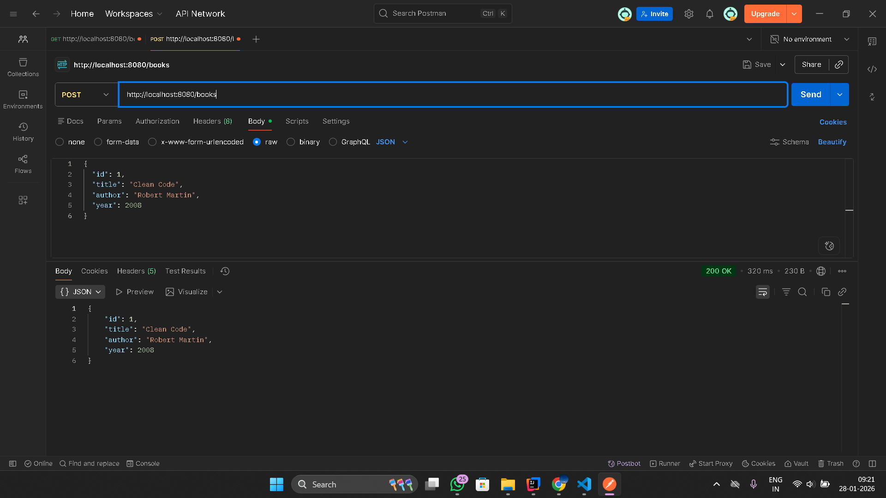
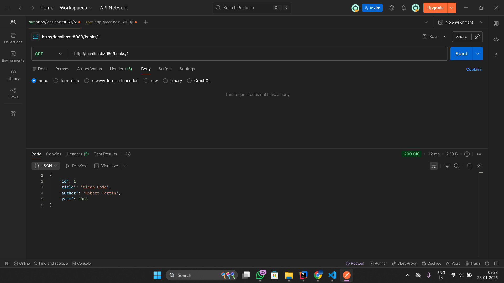
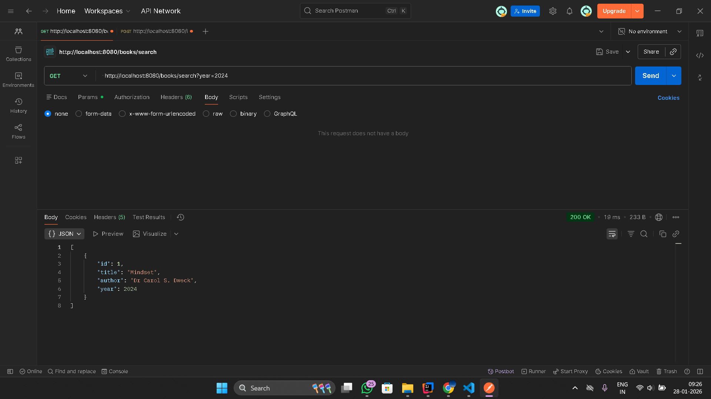
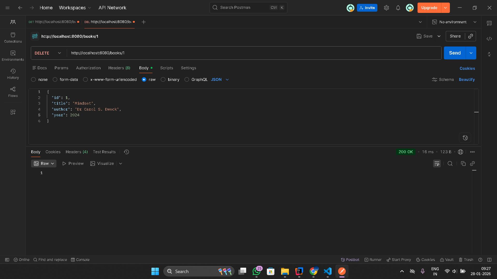

# In-Memory Library API

A simple REST API for managing books in memory using Spring Boot, built as part of a zimetrics technical assessment.

---

## Setup Instructions

**Prerequisites:**
- Java 11 
- Maven 

**Steps to run:**

```bash
# Navigate to project folder
cd c:\zimetrics

# Run the application
mvn spring-boot:run
```

The server will start on `http://localhost:8080`

---

## The Logic

**Why this approach?**

I used a `HashMap<Integer, Book>` for storage because it provides O(1) lookup time for fetching books by ID. This is the simplest and most efficient in memory solution for a small dataset. The three layer architecture (Controller -> Service -> Model) keeps the code organized and follows separationn of concerns, which is a standard practice in enterprise applications.

---
**Challenge that I faced building this:**

Initially, I was returning `null` directly from the controller when a book was not found, which caused a 200 OK response instead of 404. The fix was to use `ResponseEntity<>` and explicitly return `HttpStatus.NOT_FOUND` when the book doesn't exist. This ensures proper HTTP semantics and makes the API behavior predictable for clients.


---

## Output Screenshots

### POST a book


### GET a book by id


### Search by year


### Delete a book by id



---

## Future Improvements

1. **Add input validation** - Check for null values and duplicate IDs before saving
2. **Exception handling** - Create a global exception handler for cleaner error responses
 


---


